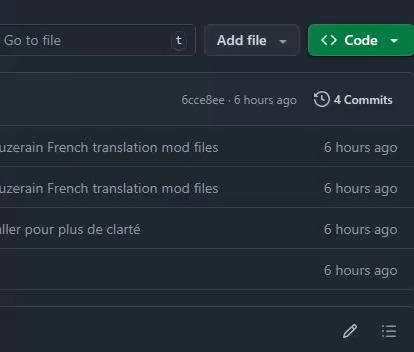
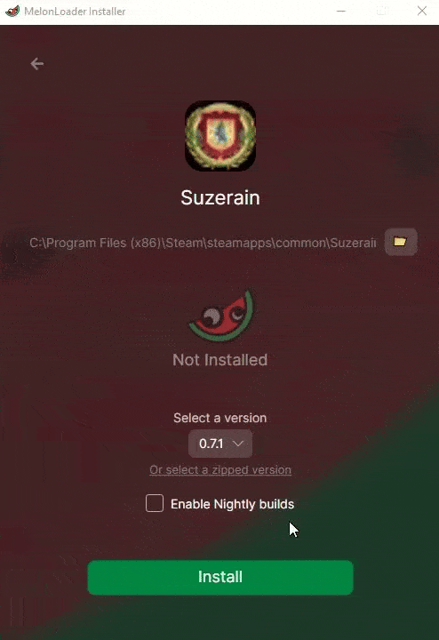

# Guide d'Installation - Patch Français pour Suzerain

## 📋 À propos de cette traduction

Ce patch Français de Suzerain vous permet de profiter du jeu dans la langue de Molière. La traduction est globalement très solide et restitue fidèlement la grande majorité des dialogues, interactions et ambiances du jeu.

### Points à noter

- Afin de respecter au mieux le ton original, quelques rares libertés d'adaptation ont été prises par votre fidèle serviteur. Par exemple, "Maroon Palace" devient ici "Palais Carmin", plus préstigieux et sérieux en Français que "Le Palais Marron", pour des raisons évidentes.
- Vous pourrez rencontrer quelques coquilles (ex: "La Sordie" au lieu de "Sordland" dans une poignée de lignes de dialogue).
- Ces petites erreurs n'affectent pas la compréhension générale du jeu

---

## 📥 Téléchargement

1. Cliquez sur le bouton vert **"Code"** en haut de cette page.
2. Sélectionnez **"Download ZIP"**
3. Dézippez le .zip dans un dossier de votre choix

---

## 🛠️ Installation

🆕 Première installation

### Étape 1 : Installation de MelonLoader

1. **Lancez** `MelonLoader.Installer.exe`

   > Si vous avez déjà une version de MelonLoader pour Suzerain, désinstallez-la d'abord

2. **Sélectionnez** Suzerain dans le menu MelonLoader
3. **Choisissez** la version **0.7.2**
4. **Cliquez** sur "Install"

### Étape 2 : Installation du patch de traduction

1. **Lancez** `SuzerainTranslationInstaller.exe`

   > Un menu simple (mais efficace) s'ouvrira

2. **Vérifiez le chemin** vers Suzerain
   - Il devrait être détecté automatiquement
   - Sinon, localisez manuellement : `Steam\steamapps\common\Suzerain\Suzerain.exe`
3. **Cliquez** sur "INSTALLER"

**C'est terminé !** Lancez le jeu et profitez ! 🎮

🔄 Mise à jour

Pas besoin de réinstaller MelonLoader, il suffit de mettre à jour le patch :

1. **Téléchargez** la nouvelle version du mod (bouton vert **"Code"** → **"Download ZIP"**)
2. **Dézippez** le contenu dans un dossier de votre choix
3. **Lancez** `SuzerainTranslationInstaller.exe`
4. Cliquez sur **"DÉSINSTALLER"** pour retirer l'ancienne version
5. Cliquez sur **"INSTALLER"** pour appliquer la nouvelle

**C'est tout !** 🎮

---

## ⏳ Premier lancement

Lors du tout premier lancement :

- MelonLoader finalisera automatiquement son installation
- Le jeu restera en freeze / pause pendant quelques secondes à quelques minutes
- **C'est normal** si la fenêtre Suzerain ne répond pas temporairement
- Soyez patient, le processus se terminera automatiquement

---

## 🎯 Compatibilité

Ceci est une mise à jour du 20/06/26, qui corrige les problématiques dûes aux récents changements d'architecture de Suzerain.

**Amusez-vous bien !**